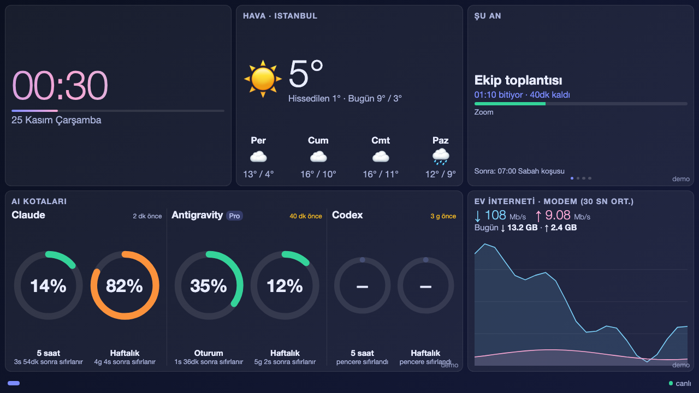
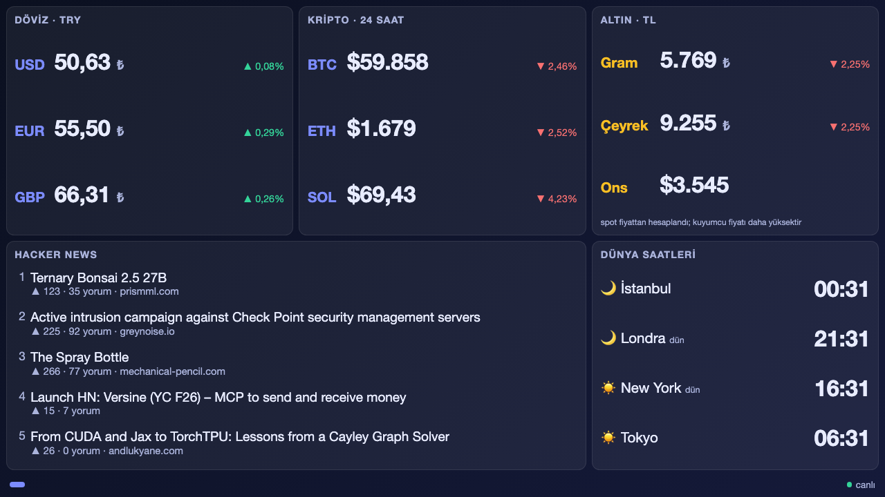
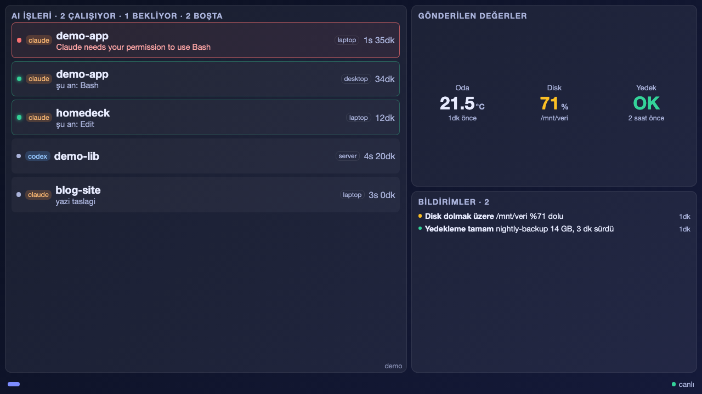
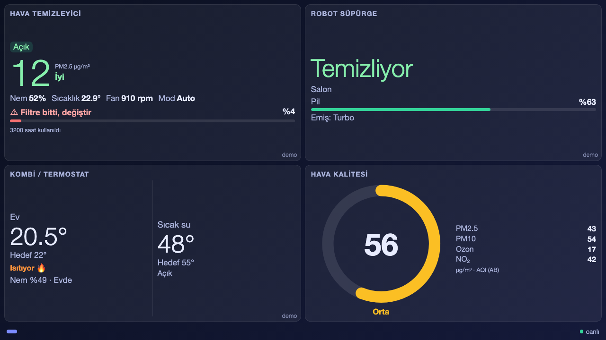
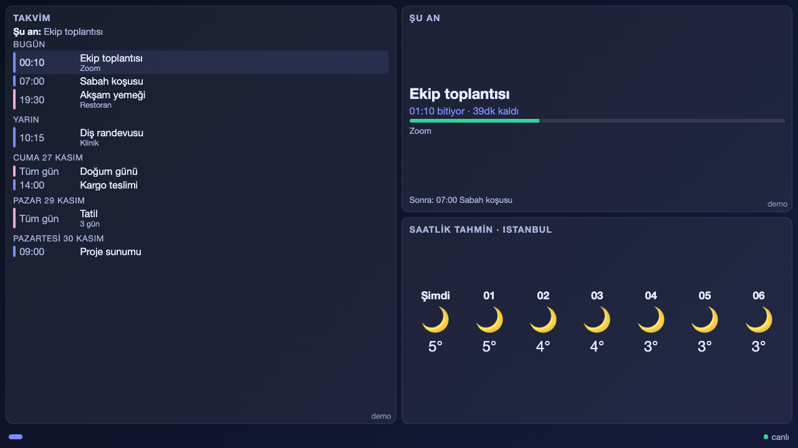
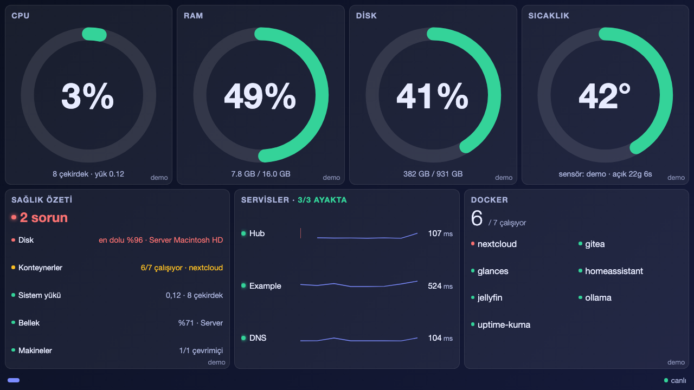

# HomeDeck

A zero-dependency (Node 20+) dashboard hub that turns a spare tablet or old phone into an always-on home-server display. Live data over SSE, vanilla-JS client that works on old WebViews, drag-and-drop layout editor, runs in Docker.

**English** | [Türkçe](README.tr.md)

> The UI language is Turkish.

## Screenshots

Captured in demo mode (sample data, no real accounts). The default layout has ten pages; six are shown.

<p>
 
</p>
<p>
 
</p>
<p>
 
</p>

## Features

- **Machines**: a tiny agent (single file, Node 18.15+; macOS / Linux / Windows) reports CPU, RAM, disks, network, temperature, optional GPU and battery.
- **Service checks**: up/down and response time for any URLs or TCP ports you list (`SERVICES`), with a latency sparkline.
- **Now playing**: track info and ⏮ ⏯ ⏭ controls for Apple Music and Spotify on macOS (opt-in agent feature).
- **Health summary**: one glance at load, disk, memory, temperature, containers and machines (warns before things break).
- **Docker** container list through a read-only socket proxy, **system** metrics, **modem** traffic counter (UPnP/IGD).
- **Weather, sun & moon, air quality** (Open-Meteo, no key), **calendar** and **smart-home devices** via Home Assistant (read-only).
- **Markets**: FX, crypto, gold (Turkish sources + PAXG), Hacker News. All keyless public APIs; set `MARKET=off` to disable.
- **AI tools**: Claude Code session hooks (working / waiting / idle) and AI quota bars.
- **Gitea panel** (recent commits + CI), **webhook** (`POST /api/push`) to show any value or notification from your own scripts.
- **Smart Stack**, next-event, world clocks, word clock, and an iPhone-style **layout editor** (long-press, drag, resize, pages, undo, backups).
- **Network lock-down**: viewer and ingest allow-lists, per-machine tokens, optional access token.

## Quick start (development)

```bash
npm start            # http://localhost:8787
```

On macOS/Windows, system metrics and Docker are simulated (marked "demo"). On Linux you get real data. To reproduce the screenshots use demo switches: `DEMO_SESSIONS=1`, `DEMO_QUOTAS=1`, `DEMO_CALENDAR=1`, `DEMO_HA=1`, `DEMO_MODEM=1`.

## Deploy with Docker

```bash
cp .env.example .env     # fill in SERVER_TOKEN, VIEWER_IP, EDIT_PIN ...
docker compose up -d --build
```

Open `http://<server-ip>:8787` on the display device. Compose runs the hub, a read-only `docker-socket-proxy`, and the server's own agent (`agent-server`).

## Configuration

Everything is environment variables; see [`.env.example`](.env.example) and [`docker-compose.yml`](docker-compose.yml).

| Variable | Purpose |
|---|---|
| `SERVER_TOKEN` | token of the server's own agent (required; `openssl rand -hex 16`) |
| `VIEWER_IP` | fixed IP of the display device; only it (and localhost) may view the UI/API |
| `EDIT_PIN` | PIN for the layout editor. Empty = editing disabled |
| `EXTRA_AGENT_TOKENS` | more machines: `,laptop:token,desktop:token` |
| `VIEWER_EXTRA` | extra viewer CIDRs, e.g. `,192.0.2.20/32` |
| `WEATHER_CITY/LAT/LON` | location (default Istanbul) |
| `HA_URL`, `HA_TOKEN` | Home Assistant: calendar + devices (read-only) |
| `GITEA_URL`, `GITEA_REPOS`, `GITEA_TOKEN` | Gitea panel (all three required) |
| `SERVICES` | service checks: `Name=http://host:port,Other=tcp://host:22` (max 8) |
| `MODEM_UPNP` | modem UPnP base URL (feature off when unset) |
| `PUSH_TOKEN` | extra bearer token for the webhook |
| `ACCESS_TOKEN` | required if you ever expose the hub beyond your LAN |

## Adding machines

Each machine runs `agent/agent.js`; its identity comes from its token (20 s without data = offline).

```bash
# macOS (needs Node). On Linux run: node agent/agent.js with HUB_URL, AGENT_HOST, AGENT_TOKEN set
./agent/install-macos.sh http://<server-ip>:8787 <TOKEN> laptop "Laptop"
```

```powershell
# Windows (needs Node)
powershell -ExecutionPolicy Bypass -File .\install-windows.ps1 -Hub http://<server-ip>:8787 -Token <TOKEN> -HostId desktop -Label "Desktop"
```

Add `laptop:<TOKEN>` to `EXTRA_AGENT_TOKENS`. Logs: `~/.homedeck-agent/agent.log` (macOS), `C:\HomeDeckAgent\agent.log` (Windows). Windows one-click updates: [`agent/WINDOWS-UPDATE.txt`](agent/WINDOWS-UPDATE.txt).

## Webhook

```bash
curl -X POST http://<server-ip>:8787/api/push \
  -H "Authorization: Bearer <AGENT_OR_PUSH_TOKEN>" -H "Content-Type: application/json" \
  -d '{"id":"backup","label":"Backup","value":"OK","sub":"2 min ago","level":"ok"}'
# notification: {"title":"Disk","text":"90% full","level":"warn","ttl":120}
```

Values are keyed by `id` (same id overwrites); notifications expire after `ttl` minutes (default 60).

## AI session hooks (Claude Code)

```bash
node hooks/install-hooks.mjs --dry-run   # show what it would do
node hooks/install-hooks.mjs             # install (backs up ~/.claude/settings.json)
node hooks/install-hooks.mjs --uninstall
```

The machine must already run the agent. Hooks never block Claude Code (exit code 0, circuit breaker). The first prompt of a session is shown as its title; disable with `HOMEDECK_TITLES=0`.

### Claude quota (opt-in, unofficial)

An optional agent mode reads Claude Code's OAuth token and queries an **undocumented** Anthropic usage endpoint (method adapted from PhoneBox, MIT). It may break at any time and may fall in a gray area of the provider's terms; it is **off by default**. See `node agent/claude-usage.mjs --probe` and the comments in `agent/claude-usage.mjs` before enabling it with `"claudeUsage": "oauth"` in `agent.config.json`.

## Now playing (Apple Music / Spotify on macOS)

The "Müzik" page (or `＋ Widget` → Now playing) shows the current track and ⏮ ⏯ ⏭ buttons that control the app. The macOS agent reads and controls the Music app and Spotify desktop with AppleScript; no account or API key needed.

- **Enable (opt-in):** add `"media": true` to `~/.homedeck-agent/agent.config.json` and restart the agent (`launchctl kickstart -k gui/$(id -u)/com.homedeck.agent`). `AGENT_MEDIA=1` also works.
- **Permission:** macOS asks once to let the agent control Music/Spotify (System Settings → Privacy & Security → Automation).
- The agent never launches a music app; it only talks to one that is already running.
- Button presses go screen → hub (`POST /api/media/command`, viewer addresses only) → agent (next request, ≤ ~3 s).
- Album art appears for Spotify only. Phone apps, YouTube Music and browser players are not supported.

## Layout editor

Long-press any widget, enter the PIN, then drag to move (edge-hold changes page), tap to resize, `＋ Widget` to add, `−` to remove, `Geri al` to undo. Changes save automatically; the last 10 backups live in `data/backups`. Use `?profile=name` for per-device layouts. The default layout is [`config/layout.json`](config/layout.json) (12×6 grid).

## Security model

- Viewer / ingest allow-lists are separate; requests from other addresses get `403`. `X-Forwarded-For` is not trusted.
- Per-machine bearer tokens for agents; `docker.sock` is only reachable through a read-only proxy.
- Secrets stay in the hub environment and are never sent to the display.
- The PIN is weak protection: keep HomeDeck on your LAN/VPN. Set `ACCESS_TOKEN` before exposing it anywhere else.
- Report vulnerabilities privately via GitHub security advisories.

## Project layout

```
server/collectors/   data sources: { name, interval, run() } (add one file + one line in index.js)
server/              hub (SSE, ingest endpoints, layout store, netguard)
public/              client (vanilla JS, no build step)
agent/               machine agents and installers
hooks/               Claude Code hook installers
config/layout.json   default layout
```

## Credits & license

Quota method adapted from [PhoneBox](https://github.com/ersinkoc/phonebox) (MIT). Weather/air by Open-Meteo, FX by Frankfurter, crypto by CoinGecko, gold by Truncgil Finans.

[MIT](LICENSE) · [Contributing](CONTRIBUTING.md) · [Security](SECURITY.md)
